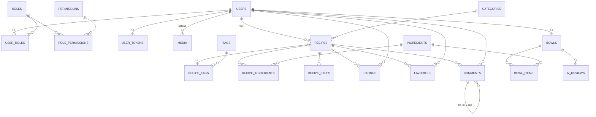

# Recipe Hub — Tài liệu thiết kế

Ngày chốt: 2026-11-25. Nguồn: phiên grilling 3 vòng.

## 1. Sản phẩm

Web chia sẻ công thức nấu ăn, chạy localhost.

| Vai trò | Làm được gì |
|---|---|
| Khách | Xem/tìm công thức đã xuất bản (theo tên, danh mục, tag, nguyên liệu) |
| MEMBER | + viết công thức, chấm điểm, bình luận, yêu thích, trang **Cái bát AI** |
| MODERATOR | + duyệt/từ chối/ẩn công thức, ẩn đánh giá & bình luận, quản lý danh mục/tag/nguyên liệu, xem danh sách user |
| ADMIN | Toàn quyền, quản lý user, role, gán quyền cho role |

## 2. Công nghệ

- Monorepo: `backend/`, `frontend/`, `docker-compose.yml` (Postgres 17 cổng host **5434**, Mailpit SMTP 1025 / UI 8025). BE/FE chạy native.
- Backend: Java 25, Spring Boot **4.2.0**, Maven wrapper, Spring Web MVC, Data JPA (Hibernate 7), Flyway, Validation, Security, Session JDBC, Mail, MapStruct 1.6.x, Spring AI **2.1.0** (`spring-ai-starter-model-openai`). DTO = `record`, không Lombok. Package gốc `com.recipehub`, chia theo tính năng.
- Frontend: một app Vue 3 + Vite + TypeScript + Pinia + Vue Router; `/admin/*` lazy-load và dùng PrimeVue 5 (preset Aura); trang công khai dùng CSS tự viết. HTTP bằng `fetch` wrapper, không axios.
- Test: JUnit 5 + Mockito (service), `@WebMvcTest` (controller + 401/403), `@DataJpaTest` + Testcontainers Postgres (repository), `@SpringBootTest` + Testcontainers cho luồng session/đăng nhập, Vitest + Vue Test Utils (frontend). Test không gọi AI thật. **Cổng giai đoạn:** `./mvnw verify` và `npm run test` xanh 100%.

## 3. Xác thực & phân quyền

- Session cookie (Spring Session JDBC, bảng trong Postgres). CSRF bật, token qua cookie `XSRF-TOKEN` → header `X-XSRF-TOKEN`. Frontend gọi `GET /api/auth/csrf` lúc khởi động. Chưa đăng nhập → 401 JSON (không redirect).
- Đăng nhập chỉ khi email đã xác thực (`EMAIL_NOT_VERIFIED`) và không bị khóa (`ACCOUNT_LOCKED`).
- Mật khẩu: BCrypt, 8–72 **byte** UTF-8. Email lưu dạng `trim().toLowerCase()`. Username `^[a-zA-Z0-9_]{3,30}$`.
- Token xác thực email (hạn 24h) và đặt lại mật khẩu (hạn 30 phút): 32 byte `SecureRandom`, base64url gửi qua mail, DB chỉ lưu SHA-256 hex. Dùng 1 lần. Tạo token reset mới vô hiệu các token reset chưa dùng trước đó. `forgot-password` và `resend-verification` luôn trả 202.
- Khóa user → xóa mọi session của user đó (`FindByIndexNameSessionRepository`).
- Admin đầu tiên: `AdminBootstrap` tạo khi chưa có user mang role ADMIN và có env `ADMIN_EMAIL`, `ADMIN_PASSWORD` (đã xác thực sẵn).

### Quyền (cố định, seed bằng Flyway; code kiểm tra bằng `hasAuthority`)

| Permission | MEMBER | MODERATOR | ADMIN |
|---|:-:|:-:|:-:|
| `RECIPE_WRITE` | ✓ | ✓ | ✓ |
| `COMMUNITY_PARTICIPATE` | ✓ | ✓ | ✓ |
| `AI_BOWL_USE` | ✓ | ✓ | ✓ |
| `MEDIA_UPLOAD` | ✓ | ✓ | ✓ |
| `CONTENT_MODERATE` | | ✓ | ✓ |
| `CATALOG_MANAGE` | | ✓ | ✓ |
| `USER_READ` | | ✓ | ✓ |
| `USER_MANAGE` | | | ✓ |
| `ROLE_MANAGE` | | | ✓ |

- Role do admin tạo/sửa (tên, mô tả, tập quyền). Role `system` (ADMIN, MODERATOR, MEMBER) không xóa được; **quyền của ADMIN không sửa được**. Đăng ký → MEMBER.
- Không được: tự khóa/xóa chính mình, gỡ role ADMIN khỏi admin cuối cùng (`SELF_ACTION`, `LAST_ADMIN`).
- Sở hữu: chỉ tác giả sửa/xóa/gửi duyệt công thức của mình; `CONTENT_MODERATE` được ẩn/hiện và xóa.

## 4. ERD



Mọi bảng: `id BIGINT GENERATED ALWAYS AS IDENTITY` (trừ bảng nối khóa ghép), `created_at`, `updated_at TIMESTAMPTZ NOT NULL DEFAULT now()`.

| Bảng | Cột | Ràng buộc / FK (ON DELETE) |
|---|---|---|
| users | email, username, password_hash, display_name, avatar_media_id, email_verified_at, locked | email, username UNIQUE; avatar → media SET NULL |
| roles | code, name, description, system | code UNIQUE |
| permissions | code, description | code UNIQUE |
| user_roles | user_id, role_id | PK ghép; user CASCADE; role **RESTRICT** |
| role_permissions | role_id, permission_id | PK ghép; role CASCADE; permission RESTRICT |
| user_tokens | user_id, type, token_hash, expires_at, used_at | token_hash UNIQUE; user CASCADE |
| media | owner_id, storage_key, content_type, size_bytes | storage_key UNIQUE; owner CASCADE |
| categories | name, slug, sort_order | name, slug UNIQUE |
| tags | name, slug | name, slug UNIQUE |
| ingredients | name, slug, group, emoji, status, created_by | UNIQUE(lower(name)), slug UNIQUE; created_by SET NULL |
| recipes | author_id, category_id NULL, title, slug, summary, servings, prep_minutes, cook_minutes, difficulty, status, cover_media_id, rejection_reason, reviewed_by, reviewed_at, published_at | slug UNIQUE; author **RESTRICT**; category RESTRICT; cover SET NULL; reviewed_by SET NULL |
| recipe_tags | recipe_id, tag_id | PK ghép; recipe CASCADE; tag CASCADE |
| recipe_ingredients | recipe_id, ingredient_id, quantity NUMERIC(10,2), unit, note, position | UNIQUE(recipe_id, ingredient_id); recipe CASCADE; ingredient RESTRICT |
| recipe_steps | recipe_id, step_no, content, media_id | UNIQUE(recipe_id, step_no); recipe CASCADE; media SET NULL |
| ratings | user_id, recipe_id, stars, review, hidden | UNIQUE(user_id, recipe_id); CHECK stars 1–5; user **RESTRICT**; recipe CASCADE |
| favorites | user_id, recipe_id, created_at | PK ghép; cả hai CASCADE |
| comments | recipe_id, author_id, parent_id, content, hidden | recipe CASCADE; author **RESTRICT**; parent CASCADE |
| bowls | user_id, name | user CASCADE |
| bowl_items | bowl_id, ingredient_id, quantity, unit | UNIQUE(bowl_id, ingredient_id); bowl CASCADE; ingredient RESTRICT |
| ai_reviews | bowl_id, user_id, model, score, summary, result JSONB, prompt_tokens, completion_tokens, status | bowl CASCADE; user CASCADE |

**Xóa user:** nhờ các FK RESTRICT (recipes, ratings, comments) — user có nội dung cộng đồng thì DB từ chối → 409 `USER_HAS_CONTENT`; bowls/favorites/tokens/media tự xóa theo.

Enum (lưu VARCHAR):
- `RecipeStatus`: DRAFT, PENDING, PUBLISHED, REJECTED, HIDDEN
- `Difficulty`: EASY, MEDIUM, HARD
- `Unit`: G, KG, ML, L, TSP (thìa cà phê), TBSP (thìa canh), CUP (cốc), PIECE (cái/quả), PINCH (nhúm)
- `IngredientGroup`: VEGETABLE, FRUIT, MEAT, SEAFOOD, EGG_DAIRY, GRAIN, SPICE, SAUCE, OTHER
- `IngredientStatus`: APPROVED, PENDING
- `TokenType`: VERIFY_EMAIL, RESET_PASSWORD
- `AiReviewStatus`: SUCCESS, FAILED

## 5. Quy trình công thức

| Hành động | Từ | Sang | Ai |
|---|---|---|---|
| tạo | — | DRAFT | tác giả |
| sửa | DRAFT, REJECTED | giữ nguyên | tác giả |
| sửa | PUBLISHED | **PENDING** | tác giả |
| gửi duyệt | DRAFT, REJECTED | PENDING (cần category, ≥1 nguyên liệu, ≥1 bước) | tác giả |
| duyệt | PENDING | PUBLISHED (+published_at, reviewed_by/at) | CONTENT_MODERATE |
| từ chối | PENDING | REJECTED (+rejection_reason bắt buộc) | CONTENT_MODERATE |
| ẩn | PUBLISHED | HIDDEN (+lý do) | CONTENT_MODERATE |
| hiện lại | HIDDEN | PUBLISHED | CONTENT_MODERATE |
| xóa | mọi trạng thái | — | tác giả hoặc CONTENT_MODERATE |

Sai chuyển trạng thái → 409 `INVALID_TRANSITION`. Công thức không PUBLISHED chỉ tác giả và CONTENT_MODERATE thấy; người khác nhận **404**.

Tìm theo nguyên liệu: `ingredientIds` = công thức chứa **tất cả** nguyên liệu đã chọn.

## 6. Cộng đồng

- Chấm 1–5 sao + nhận xét ≤1000 ký tự, 1 lần/user/công thức (upsert), không chấm công thức của mình. Trung bình và số lượt tính bằng truy vấn, bỏ qua đánh giá `hidden`.
- Yêu thích: PUT/DELETE idempotent.
- Bình luận 1–1000 ký tự, trả lời đúng 1 cấp (trả lời một câu trả lời → 400 `COMMENT_DEPTH`). Tác giả xóa bình luận của mình (xóa theo các trả lời). Moderator ẩn/hiện.
- Chỉ tương tác với công thức PUBLISHED, còn lại 404.

## 7. Cái bát AI

- Trang riêng `/bowl`. Bảng màu nguyên liệu (APPROVED) theo nhóm + tìm kiếm + emoji; bấm để thả vào bát (có hiệu ứng), kéo-thả HTML5 trên desktop. Mỗi dòng: số lượng (>0, ≤100000) + đơn vị. Tối đa 20 nguyên liệu; bát lưu được khi rỗng, nhưng nhận xét cần ≥1.
- Bát lưu lại, có tên (1–60 ký tự), có lịch sử các lần nhận xét.
- Nút "AI nhận xét": nhận xét 1 lần, không chat. Hạn mức **20 lần/user/ngày** (mọi lần bấm, kể cả thất bại; ngày theo `Asia/Ho_Chi_Minh`) → 429 `AI_QUOTA_EXCEEDED`.
- Kết quả (tiếng Việt), backend validate:
  ```json
  {
    "score": 0-100,
    "summary": "…",
    "issues":      [{ "type": "PROPORTION|CONFLICT|MISSING", "message": "…" }],
    "suggestions": [{ "action": "ADD|REMOVE|ADJUST", "ingredient": "tên", "quantity": 200, "unit": "G", "reason": "…" }],
    "dishIdeas":   [{ "name": "…", "description": "…" }]
  }
  ```
  Backend dò `ingredient` trong danh mục theo slug → gắn `ingredientId` (null nếu không thấy; nút "Áp dụng" bị tắt). "Áp dụng" làm ở frontend rồi lưu bát. JSON sai (sau khi bóc ```json fence) → gọi lại 1 lần → vẫn sai hoặc lỗi nhà cung cấp/timeout 30s → lưu `FAILED`, trả 502 `AI_UNAVAILABLE`. Thiếu API key → 503 `AI_NOT_CONFIGURED`.
- "Tạo công thức từ bát này" → công thức DRAFT, title = tên bát, nguyên liệu và định lượng copy từ bát.
- Nhà cung cấp mặc định: `gpt-oss-120b` qua Groq (`https://api.groq.com/openai`, model `openai/gpt-oss-120b`) hoặc OpenRouter; cấu hình qua env `AI_BASE_URL`, `AI_API_KEY`, `AI_MODEL`. Đổi sang OpenAI trả phí/Ollama chỉ đổi env.

## 8. Ảnh

Lưu local `uploads/` (đường dẫn cấu hình `app.storage.dir`), tên file UUID. ≤5MB (413 `MEDIA_TOO_LARGE`), chỉ jpg/png/webp, kiểm tra magic bytes (415 `MEDIA_TYPE`). Phục vụ qua `GET /api/media/{id}/file`. Tách `StorageService` để có thể đổi sang MinIO.

## 9. Quy ước API

- Mọi endpoint dưới `/api`. Lỗi trả `ProblemDetail` + thuộc tính `code` (enum `ErrorCode`), lỗi validate kèm `errors: {field: message}`.
- Phân trang: `page` (0-based), `size` (mặc định 12, tối đa 50); JSON `{content, page: {size, number, totalElements, totalPages}}`.
- Slug: bỏ dấu tiếng Việt (kể cả đ/Đ → d), chữ thường, `-` nối; trùng thì thêm `-2`, `-3`…

## 10. Lộ trình

| GĐ | Nội dung | Kế hoạch |
|---|---|---|
| 0 | Dựng khung | `plans/2026-11-25-recipe-hub-phase-0-scaffold.md` |
| 1 | Tài khoản & phân quyền | `plans/2026-11-25-recipe-hub-phase-1-accounts.md` |
| 2 | Ảnh & danh mục | `plans/2026-11-25-recipe-hub-phase-2-catalog.md` |
| 3 | Công thức | `plans/2026-11-25-recipe-hub-phase-3-recipes.md` |
| 4 | Cộng đồng | `plans/2026-11-25-recipe-hub-phase-4-community.md` |
| 5 | Cái bát AI | `plans/2026-11-25-recipe-hub-phase-5-ai-bowl.md` |

Mỗi giai đoạn làm trọn BE (entity → repository → service → controller, test từng tầng) rồi FE của phần đó.

## Ngoài phạm vi

OAuth Google, 2FA, chat AI nhiều lượt, follow/thông báo/bộ sưu tập, xóa mềm, MinIO, E2E Playwright, deploy.
